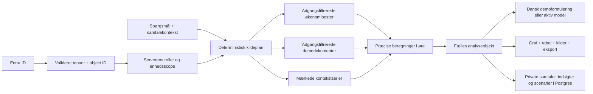
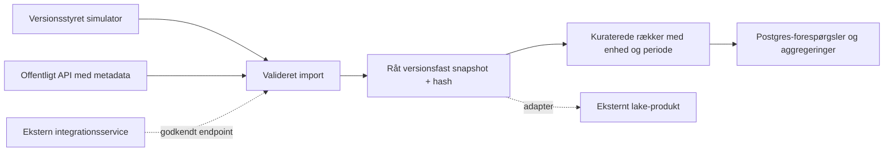

# K.A.I.A. – arkitektur og faktisk første version

K.A.I.A. er en selvstændig Next.js-applikation. DGITA er en læst designreference. Alle kommunale økonomital, fakturaer, elevtal, dokumenter, beslutninger og demografiforudsætninger er simulerede. Et valgfrit offentligt kontekstlag holdes adskilt og ændrer ikke denne status.

Standarddatasættet `KAIA-DEMO-2026.09-v4` dækker **2020–2032** med reference 30. september 2026: **1.245.024 økonomiposteringer**, **1.742 dokumenter**, **6 kommuneprofiler** og **16.506 benchmarkrækker**. Kun kommunernes navne og koder er officielle; alle strukturtræk og økonomiske sammenligninger er syntetiske. Ældre versioner og personlige analysesnapshots bevares.

## Forespørgsler og adgang

Identitet, visningsprofil og autorisation er separate begreber. Klientens rollefelter eller et dokumentindhold giver ingen rettigheder. Den fælles `src/domain/policy.ts` afgør tilladte enheder og dokumentklassifikationer. `src/integrations/policy.ts` genbruger disse regler og tilføjer kilde, operation og periode. Et udvalgs scope udvides efter demoorganisationens dokumenterede relationer; navne eller stillinger gør det aldrig.

`planQuery` vælger økonomi, dokumenter og eventuel pris-/demografikontekst deterministisk. `authorizePlan` kan kontrollere en begrænset, struktureret modelplan. Alle trin valideres igen inden udførelse. `enrichAnalysisWithContext` udfører faktisk de godkendte serietrin og lægger observationer, metadata, kildehenvisninger og forklaringer i det fælles analyseobjekt. Manglende valgfri offentlig dækning forklares, mens den tilladte lokale økonomianalyse bevares. Et modelværktøj har lukket inputskema og bruger sessionens adgang. Der er ingen modelgenereret SQL, kode eller shell.

`Analysis` er kontrakten mellem beregning, svar, evidens, figur og eksport: dataversion, periode, enheder, metrics, kilder, diagramrækker, antagelser og opfølgninger. Et gemt analysesnapshot indeholder dette objekt. Den sproglige model kan formulere et svar, mens beløb, scenarieeffekt og diagramværdier kommer fra serverberegningen. Dokumenter behandles som citerbare data, og tekstsøgning virker uden embeddingtjeneste.

`src/domain/projections.ts` samler flerårsprognoser direkte fra ledgerens budget og realiserede/prognosticerede måneder. Lavt/højt er ±1 % ekstra årlig multiplikativ følsomhed på fremtidige udgifter, med faktorerne `0,99^trin` og `1,01^trin`; realiserede poster og indtægter bevares. `src/domain/comparisons.ts` beregner sammenlignelige år og kommuner. `src/domain/municipalities.ts` genererer fem syntetiske peers og viderefører kun Kalundborgaggregater fra den eksisterende ledger. Kommunebenchmarks kræver hele det relevante fagområde, samme måneder og normalisering pr. elev/indbygger. Strukturvægtet peerudvælgelse er forklarlig, men er ingen faktisk kommunal rangering. Se [FORECASTS.md](FORECASTS.md) og [MUNICIPAL-BENCHMARKS.md](MUNICIPAL-BENCHMARKS.md).

## Fremblik-dashboard

Den godkendte Fremblik-arbejdsflade er en visning af samme autoriserede analyselag. `GET /api/dashboard` samler et scope- og versionsafgrænset udtræk til typed paneler; `POST /api/dashboard/scenario` er en begrænset serverberegning uden modelkald eller vedvarende analyse. `src/domain/dashboard-analysis.ts` samler eksisterende budget-, prognose-, peer- og scenariefunktioner. Der oprettes ingen samtale ved almindelig dashboardvisning.

Klienten afbryder forældede requests og viser kun et svar, der matcher identitet, roller, enhedsscope, periode og snapshot. Et scenarie har eksplicit helårs-/resterende virkning. Historiske år kræver brugerens helårsvalg. En handling som Undersøg scenariet går gennem den almindelige analyse-API; først da oprettes et brugerbundet analyseobjekt, der kan gemmes. CSV, SVG og tabel bruger det modtagne autoriserede analyseobjekt. Serveren bevarer al myndighed over adgang og beregninger.

Den aktuelle hybridopsætning bruger de aftalte normale demoprofiler, mens Entra forbliver den implementerede fremtidige driftsmulighed. Se [hybriddriften](HYBRID-DEMO.md) og [dashboardverifikationen](DASHBOARD-VERIFICATION.md).

## Indlæsning og datalake

`LakeAdapter` adskiller lagringsproduktet fra indlæsningskontrakten. `PostgresLakeAdapter` gemmer både rå JSON og kuraterede rækker i `kaia_lake_snapshots` og `kaia_lake_rows`. DDL køres som en eksplicit migration. Et råt snapshot har kilde-ID, observationstid, hentetid, skema- og dataversion, SHA-256, enhedsscope og rækketal. Import af samme indhold er idempotent. Ændring under samme snapshotidentitet afvises, og overlappende rækkenøgler under samme kildeversion afvises også. Brug en ny dataversion til en rettelse. Flere ikkeoverlappende periodebatcher kan høre til samme kildeversion.

Rå og kuraterede data indsættes i én transaktion med en versionsafgrænset PostgreSQL-lås. Parametriseret SQL og `jsonb_to_recordset` undgår ét netværkskald pr. postering. Scope valideres før import og læsning. Et råt snapshot kan kun eksporteres af en bruger med adgang til hele det deklarerede enhedsscope; et snævrere scope får et filtreret kurateret udtræk. Betroede importadaptere skal afgrænse råudtrækket til samme deklarerede scope, før `ingestSnapshot` kaldes.

Den versionsstyrede generator og Postgres er første versions fulde demo-datagrundlag. Seed bevarer det fulde rå generatorudtræk: v4 har et manifest i `kaia_lake_snapshots` og 125 ordnede tekstdele i `kaia_lake_raw_chunks`, højst 10.000 ledgerrækker pr. del. Manifestet bevarer resten af generatorobjektet, og både delvise og samlede SHA-256-kontrolsummer gør det muligt at genskabe og kontrollere det oprindelige JSON-udtræk. Den samlede indholdshash kontrolleres igen ved idempotent seed. Tidligere små snapshots beholder deres rå JSONB-repræsentation. Migration `0004_raw_snapshot_chunks.sql` opretter den særskilte chunk-tabel.

Den kuraterede økonomi og dokumenterne ligger i appens typesikre tabeller. Migration `0003_expanded_dataset.sql` tilføjer versionsdækning, kommunemetadata, `kaia_municipal_profiles` og `kaia_municipal_benchmarks`. Seed duplikerer ikke hele økonomidatasættet i adapterens generiske `kaia_lake_rows`. En ekstern blob-/lake-udbyder er et adapterpunkt, som afventer konkret binding, miljø, credentials og integrationstest. `FixtureLakeAdapter` bruges kun til tests og er ikke produktionslagring. Postgres er autoritativt for personlige data og konfiguration; en Vercel-instans’ disk og proceshukommelse er det ikke.

## Integrationsgrænser

| Komponent                | Implementeret                                                                                          | Faktisk integrationsstatus                                                                                     |
| ------------------------ | ------------------------------------------------------------------------------------------------------ | -------------------------------------------------------------------------------------------------------------- |
| Datakatalog og kildeplan | Kildestatus, begreber, geografi, perioder, tilladte operationer og værktøjer                           | Automatiske kontrakt- og adgangstests                                                                          |
| Postgres-lake            | Rå og kuraterede versioner, transaktion, idempotens og filtreret læsning                               | Tre ekstra tests bestået mod rigtig lokal Postgres: JSONB roundtrip, idempotens, scope og transaktionsrollback |
| Statistikbanken          | `tableinfo` før `data`, fuldt validerede dimensioner, CSV-normalisering                                | Reel offentlig API-prøve udført 20. oktober 2026; 18 observationer fastlåst                                    |
| MCP                      | Begrænset Streamable HTTP-klient, init, tool discovery, timeout, bearer credential og outputvalidering | Lokal fixture og transportkontrakt testet; ingen kommunal MCP-server verificeret                               |
| CLI-runner               | Beskyttet HTTP-service, fast kommando-ID, validerede argumenter og struktureret svar                   | Fixture testet; ingen ekstern runner verificeret                                                               |
| Modeludbydere            | Fælles providerinterface og fire adaptere                                                              | Se [PROVIDERS.md](PROVIDERS.md); fixtures er ikke credentialbaserede forbindelsesprøver                        |
| Entra og deployment      | Serverbaseret identitets- og adgangskontrol                                                            | Se [ENTRA.md](ENTRA.md) og [VERCEL.md](VERCEL.md) for miljøkrav og verifikation                                |

MCP- og CLI-gateways er implementerede adapterkontrakter, som testes med fixtures. Chatrouteren kalder dem ikke automatisk, og miljøfelter alene aktiverer ikke eksterne værktøjer. Et konkret endpoint kræver en eksplicit serverbinding og integrationsprøve. Langvarige indlæsningsjobs og faktiske CLI-processer skal køre i det eksterne integrationsmiljø; gatewayklienten anvender kun dets beskyttede servicegrænseflade. Læseadgang er standard, og første version tilbyder ingen fjernskriveværktøjer.

## Eksterne forhold og forklaringer

Lokal energiforklaring bruger simulerede fakturalinjer med samme produkt, måned, kWh og momsgrundlag i begge perioder. Med basispris `p0`, ny pris `p1`, basismængde `q0` og ny mængde `q1` er ændringen:

`(p1 − p0) × q0 + (q1 − q0) × p0 + (p1 − p0) × (q1 − q0)`.

De tre bidrag er pris, mængde og samspil, og de summeres til den modellerede forskel. Et nationalt indeks er kontekst, aldrig tilstrækkeligt belæg for en lokal årsag. Eventuelle andre poster skal fremgå som en restforklaring. Demografimodellen adskiller aldersgrupper, fødsler/dødsfald, indenlandsk nettoflytning og nettoindvandring. Aktivitetsfølger bruger en eksplicit variabel andel, mens faste omkostninger og kapacitet holdes særskilt. Skat og udligning indgår ikke som automatisk beregning.

## Drift og sikkerhed

API-svar med private oplysninger har privat cachepolitik. Adgang og ejerskab kontrolleres på serveren for hver samtale, kilde, scenarie og eksport. Credentials forbliver på serveren og GUI-gemte hemmeligheder krypteres med miljøets nøgle. Konfigurerede integrationsendpoints kræver offentligt HTTPS, præcist godkendt host, ingen indlejrede credentials eller redirects og kontrol af DNS-adresser. Et eksternt endpoint skal være en betroet tjeneste under driftens kontrol; applikationens DNS-check erstatter ikke et driftsmiljøs egresskontrol.

Build skal kunne køre uden produktionshemmeligheder. Manglende database-/sessionsopsætning giver opsætningsstatus; Entra-tilstanden kræver desuden en konfigureret tenantforbindelse. Den godkendte hybridpræsentation bruger særskilt demologin uden Entra, med private besøgsidentiteter og samme adgangsregler. Lokale testfixtures afvises stadig i produktion. Læs [HYBRID-DEMO.md](HYBRID-DEMO.md) og [INTEGRATIONS.md](INTEGRATIONS.md) for drift, adapterkontrakter og den præcise skelnen mellem fixtures og rigtige integrationer.

## Seks trin og skolekapacitet

Det samlede forløb er implementeret med en deterministisk kapacitetsmodel, tre adgangskontrollerede katalogkilder, en gemt serverjournal og et separat Postgres-baseret godkendelsesforløb. Se [MOBILITY-FLOW.md](MOBILITY-FLOW.md) for faktiske komponenter, modelbegrænsninger og API-kontrakter. Eksterne fagsystemer er ikke tilsluttet gennem dette forløb.
